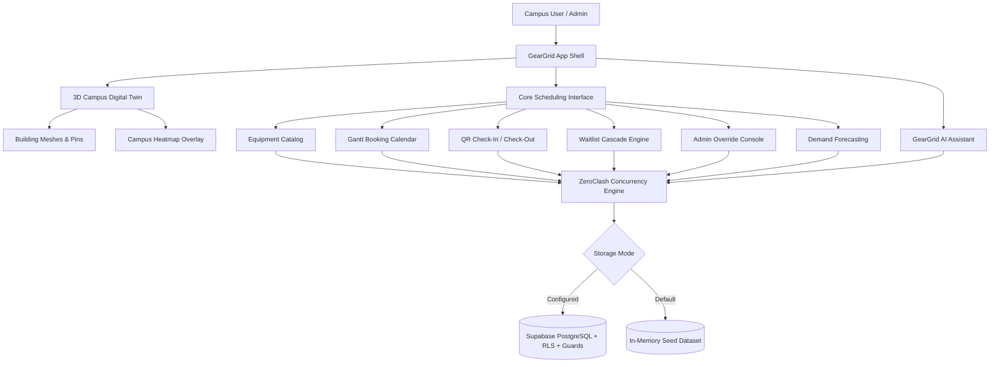

# GearGrid — Smart Campus Digital Twin

> Intelligent clash-free campus equipment scheduling powered by an interactive 3D digital twin, the ZeroClash concurrency engine, dynamic waitlist cascading, and QR-verified check-ins.

<p align="center">
  
</p>

<p align="center">
  
  
  
  
  
  
</p>

---

## Table of Contents

- [Overview](#overview)
- [Feature Architecture](#feature-architecture)
  - [1. 3D Campus Digital Twin](#1-3d-campus-digital-twin)
  - [2. ZeroClash Concurrency Engine](#2-zeroclash-concurrency-engine)
  - [3. Concurrency Simulation & Calendar](#3-concurrency-simulation--calendar)
  - [4. Waitlist Queue & Automated Cascade](#4-waitlist-queue--automated-cascade)
  - [5. QR Check-In & Check-Out](#5-qr-check-in--check-out)
  - [6. Admin Override & Audit Ledger](#6-admin-override--audit-ledger)
  - [7. Demand Intelligence](#7-demand-intelligence)
- [System Architecture](#system-architecture)
- [Implementation Roadmap](#implementation-roadmap)
- [Tech Stack](#tech-stack)
- [Local Setup & Installation](#local-setup--installation)
- [Production Build](#production-build)
- [Environment Configuration](#environment-configuration)
- [Project Directory Structure](#project-directory-structure)
- [License](#license)

---

## Overview

**GearGrid** is a smart campus equipment management platform designed to eliminate resource conflicts across academic departments, research labs, and media facilities. Combining an immersive 3D spatial interface with a conflict-free scheduling engine, GearGrid enables students, researchers, faculty, and lab managers to visualize facility availability, reserve high-demand equipment, and streamline physical check-ins.

The platform functions out-of-the-box with a high-fidelity mock dataset and supports zero-friction transition to Supabase (PostgreSQL) persistence with row-level security and conflict guards.

---

## Feature Architecture

### 1. 3D Campus Digital Twin
- **Isometric Spatial Map**: Interactive campus layout rendered with Three.js and React Three Fiber, featuring custom building volumes (Science Wing, Media Labs, Central Library Locker, Cube Archive).
- **Interactive Equipment Pins**: Floating pins showing real-time unit status (Available, Booked, Maintenance) with custom high-contrast icon sprites.
- **Dynamic Camera & Controls**: Smooth orbit damping, pan/zoom constraints, wireframe toggles, and automatic camera centering when searching or selecting units.
- **Campus Usage Heatmap**: Dynamic visual overlay reflecting aggregate hourly building utilization.

### 2. ZeroClash Concurrency Engine
- **Atomic Conflict Prevention**: Prevents overlapping bookings on identical hardware units across all active reservation states (`confirmed`, `pending`, `in-use`, `checked-in`).
- **Interval Overlap Verification**: Real-time interval checks ensuring start/end boundaries do not collide.
- **Alternative Slot Finder**: Automatically computes and recommends the nearest open time slots when an initial request conflicts with existing reservations.

### 3. Concurrency Simulation & Calendar
- **Multi-View Gantt Calendar**: Day, week, and month visual timeline showing current and upcoming bookings across all campus units.
- **Live Filtering**: Instant filtering by equipment category (DSLR Cameras, GPU Clusters, VR Headsets, Microscopes, 3D Printers, Projectors, Lab Kits, Testing Devices) and status.
- **Modal Booking Flow**: Fast reservation dialog with validation checks and immediate schedule synchronization.

### 4. Waitlist Queue & Automated Cascade
- **Multi-Factor Priority Scoring**: Automatically calculates waitlist rank based on requester role weight (`Faculty` > `Lab Admin` > `Researcher` > `Student`), urgency score, and historic no-show penalty deductions.
- **Time-Windowed Cascade Offers**: When a booking is cancelled or released early, the engine dispatches a time-limited (10-minute) offer window to the highest-ranking waitlisted user.
- **Automatic Expiration & Transition**: If an offer is declined or expires, the engine smoothly cascades the slot to the next qualified requester in line.

### 5. QR Check-In & Check-Out
- **Signed QR Tokens**: Built-in Reed-Solomon QR encoder generating secure, verifiable booking payloads.
- **Hardware & Software Scanner**: Supports device camera barcode detection via Web API with immediate fallback to simulated scanner input.
- **Strict Verification Windows**: Validates that check-ins occur within valid temporal thresholds and restricts check-outs only to previously verified units.

### 6. Admin Override & Audit Ledger
- **Administrative Control**: Direct capabilities for lab administrators to resolve booking disputes, approve/reject pending reservations, and place units under maintenance locks.
- **Append-Only Audit Log**: Every state modification, override action, and cascade offer is logged with an immutable timestamp, target, reason, and actor identity.

### 7. Demand Intelligence
- **Utilization Analytics**: Forecast summaries, peak usage day analysis, and category utilization ratios.
- **Proactive Recommendations**: Automated recommendations suggesting resource redistributions and maintenance schedules based on historical booking pressure.

---

## Implementation Roadmap

- [x] Foundation & project scaffolding (`package.json`, `tsconfig.json`, `tailwind.config.js`)
- [x] Core Scheduling Engine & schema migrations (`src/lib/`, `src/types/`, `supabase/`)
- [x] Central state store and mock campus lab inventory (`src/store/`, `src/data/`, `src/utils/`)
- [ ] 3D isometric campus twin (`src/scene/`)
- [ ] UI components and interactive dashboards (`src/components/`, `src/App.tsx`)

### Core Scheduling Engine (Milestone 2)
- ZeroClash concurrency and conflict detection algorithm with interval checking.
- Dynamic waitlist cascade queue with multi-factor priority scoring.
- QR check-in / check-out token generator and verifier.
- Supabase SQL schema migrations and advisory locking guards.

### State & Utilities (Milestone 3)
- Central Zustand state store managing live bookings, active filters, and unit states.
- Mock campus inventory representing engineering blocks, maker spaces, and computing clusters.
- Algorithmic utility helpers: reservation demand forecasting, utilization heatmaps, and QR verification matrix.

*Current Project Phase: Milestone 3 complete. 3D isometric campus twin in progress.*

---

## System Architecture



---

## Tech Stack

| Layer | Technologies |
| --- | --- |
| **Frontend Framework** | React 19, TypeScript 5.7, Vite 6 |
| **3D Graphics & Canvas** | Three.js 0.174, React Three Fiber 9, Drei 10, Postprocessing |
| **Styling & UI Tokens** | Tailwind CSS 3.4, Custom CSS theme variables (Dark/Light) |
| **State Management** | Zustand 5 (Spatial Campus Store), React State / Context |
| **Icons & Assets** | Lucide React, Custom equipment circular badges |
| **Data & Persistence** | Local seed dataset, optional Supabase PostgreSQL integration |
| **Database Migrations** | PostgreSQL schemas, RLS policies, advisory lock conflict guards |

---

## Local Setup & Installation

### Prerequisites

- **Node.js**: `v18.0.0` or higher
- **npm**: `v9.0.0` or higher

### 1. Install Dependencies

```bash
npm install
```

### 2. Start the Development Server

```bash
npm run dev
```

The application will launch locally at:
```text
http://localhost:5173
```

---

## Production Build

To validate TypeScript types and generate an optimized production bundle:

```bash
npm run build
```

To preview the production build locally:

```bash
npm run preview
```

---

## Environment Configuration

GearGrid runs completely standalone with full functionality using its built-in seed dataset.

To optionally connect a live Supabase PostgreSQL backend, create a `.env` file in the project root:

```env
VITE_SUPABASE_URL=https://your-project-ref.supabase.co
VITE_SUPABASE_ANON_KEY=your-public-anon-key
```

Then execute the database migrations in `supabase/migrations/` in your Supabase SQL editor:
1. `20261011_zero_clash_core_schema.sql`: Core tables, RLS policies, and triggers.
2. `20261010_booking_conflict_guards.sql`: Concurrency guards and transactional locking functions.

---

## Project Directory Structure

```text
.
├── public/
│   └── assets/
│       └── icons/              # Rendered equipment badges (camera, gpu, vr, etc.)
├── reference/                  # Architectural UI reference asset
├── scripts/                    # Asset helper utilities
├── src/
│   ├── components/             # Dashboards, Gantt calendar, QR, catalog, sidebar, modals
│   ├── data/                   # Campus building and equipment seed datasets
│   ├── lib/                    # Scheduling engine, Supabase data access, conflict logic
│   ├── scene/                  # Three.js 3D campus twin, camera controller, building meshes
│   ├── store/                  # Zustand campus navigation and camera store
│   ├── types/                  # Scheduling, booking, and waitlist TypeScript types
│   ├── utils/                  # Demand forecasting, QR matrix generator, heatmap math
│   ├── App.tsx                 # Root application container & layout
│   ├── main.tsx                # Application bootstrap
│   └── index.css               # Tailwind directives and cyberpunk theme tokens
├── supabase/
│   └── migrations/             # PostgreSQL DDL schemas & conflict lock functions
├── package.json                # Project dependencies and npm scripts
├── tsconfig.json               # TypeScript compiler configuration
├── tailwind.config.js          # Tailwind CSS layout configuration
└── vite.config.ts              # Vite bundler configuration
```

---

## License

MIT License.
