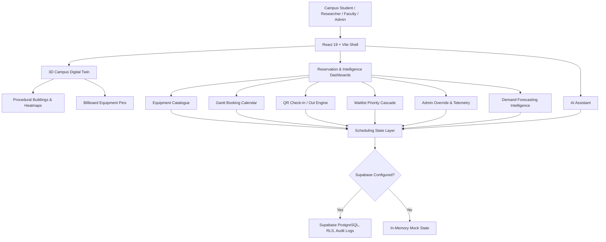

# RACK-ROOM

> Modern campus equipment reservation hub and 3D digital twin with real-time scheduling intelligence, QR check-in, waitlist cascades, and Supabase-ready persistence.

<p align="center">
  
</p>

<p align="center">
  
  
  
  
  
  
</p>

## Table of Contents

- [Overview](#overview)
- [Key Features](#key-features)
- [Tech Stack](#tech-stack)
- [Screenshots and Demo](#screenshots-and-demo)
- [Installation](#installation)
- [Environment Variables](#environment-variables)
- [Project Structure](#project-structure)
- [Architecture](#architecture)
- [Scripts](#scripts)
- [Future Improvements](#future-improvements)
- [Contributing](#contributing)

## Overview

**RACK-ROOM** is a modern equipment reservation hub and 3D digital twin engineered for academic and research institutions. It empowers students, researchers, faculty, and lab managers to discover shared equipment across campus facilities, inspect real-time building-level availability, reserve time slots clash-free, manage dynamic waitlists, validate pick-up and returns via secure QR codes, and forecast equipment demand trends.

The application operates instantly out-of-the-box using high-fidelity local demo datasets and seamlessly connects to Supabase for production-grade PostgreSQL persistence, row-level security (RLS), and audit tracking.

## Key Features

- **Interactive 3D Digital Twin**: Isometric campus visualization built with Three.js and React Three Fiber featuring procedural building structures, floating equipment pins, status indicators, and live usage heatmap overlays.
- **Conflict-Free Reservation Engine**: Interval overlap collision detection preventing double-booking race conditions across day, week, and month calendar views.
- **Dynamic Waitlist Cascade**: Automated queue prioritization considering role authority, request urgency, and historical user reliability with timed acceptance windows.
- **Touchless QR Check-In / Check-Out**: Cryptographically structured QR tokens with validation rules for physical equipment handoffs and custodial tracking.
- **Admin Control Center**: Administrative dashboard for manual overrides, scheduled hardware maintenance lockouts, approval workflows, and immutable audit logs.
- **Demand Intelligence & Predictive Analytics**: Moving-average utilization metrics, demand surge forecasts, category utilization distribution, and proactive provisioning recommendations.
- **Contextual AI Assistant**: Floating responsive assistant answering inventory availability, reservation status, and operational questions.
- **Adaptive UI**: Responsive dark/light mode with fluid sci-fi and modern glassmorphic interface aesthetics.

## Tech Stack

| Layer | Technologies |
| --- | --- |
| Frontend Core | React 19, TypeScript, Vite |
| 3D Digital Twin | Three.js, React Three Fiber, `@react-three/drei`, `@react-three/postprocessing` |
| Styling & Theme | Tailwind CSS, Lucide React, glassmorphism design tokens |
| State Management | React Hooks, Zustand |
| Persistence & Backend | Supabase client, PostgreSQL migrations, Row-Level Security (RLS) |
| Testing | Vitest |

## Screenshots and Demo

The repository includes an isometric campus digital twin reference:


High-resolution equipment icon badges are organized in `public/assets/icons/` and integrated throughout the 3D map pins, catalogue tiles, Gantt calendar, and QR check-in flows.

## Installation

### Prerequisites

- Node.js 18 or newer
- npm

### Clone the repository

```bash
git clone https://github.com/Awwad-007/RACK-ROOM.git
cd RACK-ROOM
```

### Install dependencies

```bash
npm install
```

### Start the development server

```bash
npm run dev
```

Vite will serve the local application, typically at:

```text
http://localhost:5173
```

### Run unit tests

```bash
npm test
```

### Build for production

```bash
npm run build
```

### Preview the production build

```bash
npm run preview
```

## Environment Variables

RACK-ROOM runs out-of-the-box using local mock scheduling and campus data.

To enable Supabase persistence, create a `.env` file at the project root:

```env
VITE_SUPABASE_URL=https://your-project-ref.supabase.co
VITE_SUPABASE_ANON_KEY=your-public-anon-key
```

Then apply the migrations in `supabase/migrations/` to your Supabase instance.

> **Note**: Never commit `.env` or sensitive keys. The repository `.gitignore` ensures environment variables, node modules, and build outputs remain untracked.

## Project Structure

```text
.
├── public/
│   └── assets/              # Equipment sprite sheet and icon badges
├── reference/               # UI preview and design reference
├── scripts/                 # Asset preparation and utility scripts
├── src/
│   ├── components/          # Dashboards, Gantt calendar, catalog, QR, navigation, AI assistant
│   ├── data/                # Mock campus buildings, units, and reservation data
│   ├── lib/                 # Core scheduling logic, Supabase client, and queries
│   ├── scene/               # Three.js 3D campus twin, buildings, lighting, and billboard pins
│   ├── store/               # Zustand state stores
│   ├── test/                # Unit test suites
│   ├── types/               # Domain TypeScript interfaces and types
│   └── utils/               # Forecasting, QR generation, and usage heatmap math
├── supabase/
│   └── migrations/          # PostgreSQL schemas, RLS rules, and conflict triggers
├── index.html               # Application entry point
├── package.json             # NPM package specification
├── tailwind.config.js       # Cyberpunk and modern theme configuration
└── vite.config.ts           # Vite bundler configuration
```

## Architecture



## Scripts

| Command | Description |
| --- | --- |
| `npm run dev` | Launch the Vite development server |
| `npm test` | Execute unit test suite with Vitest |
| `npm run build` | Validate TypeScript types and compile production bundle |
| `npm run preview` | Locally preview the generated production build |

## Contributing

Contributions are welcome via pull requests to `Awwad-007/RACK-ROOM`. Please ensure all type checks and tests pass (`npm run build && npm test`) before submitting code changes.
