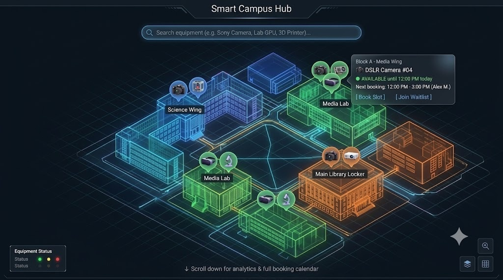
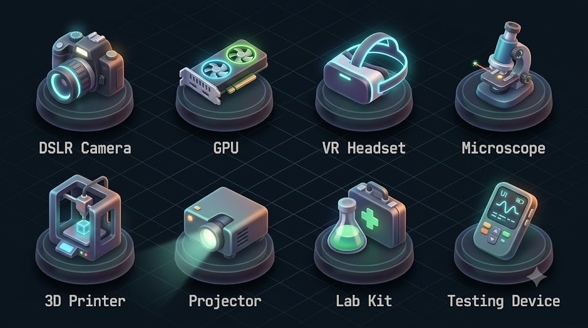
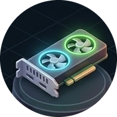
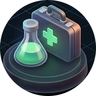
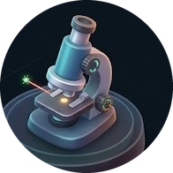
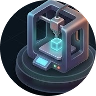
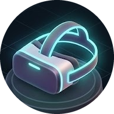

<div align="center">

# ⚡ RACK-ROOM ⚡
### *Autonomous Campus Laboratory Digital Twin & Zero-Clash Reservation Engine*

[](https://rack-room-five.vercel.app/)
[](https://vitejs.dev/)
[](https://react.dev/)
[](https://www.typescriptlang.org/)
[](https://threejs.org/)
[](https://tailwindcss.com/)
[](https://github.com/pmndrs/zustand)
[](https://supabase.com/)
[](https://vitest.dev/)

<p align="center">
  <b>🌐 Live Production Deployment:</b><br/>
  <a href="https://rack-room-five.vercel.app/">👉 https://rack-room-five.vercel.app/ 👈</a>
</p>



</div>

---

## 💥 THE ORIGIN STORY: THE 11:59 PM CAMPUS CRISIS

> *"It was 11:59 PM the night before university capstone deadlines. Squad Alpha swore on their lives they booked the solitary 8x H100 GPU cluster. Squad Beta possessed an email thread proving they reserved it three weeks ago. Meanwhile, down the hall, the precision laser cutter sat idling behind locked glass under a phantom ghost booking. Campus chaos had reached critical mass..."*

Every university engineering quadrangle battles the same three notorious campus villains:
* 👻 **The Ghost Booker**: Books four research workstations "just in case," attends none, locks down hardware while other projects freeze.
* 💥 **The Double-Booking Paradox**: Two asynchronous client transactions submit reservations simultaneously, resulting in a conflicting split-state schedule.
* 🗺️ **The Spatial Void**: Wandering blindly across three mechanical engineering wings trying to locate an available digital oscilloscope.

**RACK-ROOM** resolves this crisis through an **interval-collision scheduling engine** paired with an **interactive WebGL isometric digital twin**, delivering zero-clash reservation guarantees, dynamic QR access gates, and predictive capacity analytics.

---

## 📸 VISUAL TELEMETRY & HARDWARE CATALOG

### Procedural Campus Twin & Department Wings
The digital twin maps out active campus facilities in real-time. Hovering over any procedural architectural wing exposes telemetry, ambient occupancy, and active equipment reservations:

<div align="center">
  
</div>

### Hardware Ecosystem Matrix
From heavy GPU computing nodes to cleanroom microscopes and additive manufacturing rigs:

<div align="center">
  
</div>

<div align="center">

| Workstation | Micro-Electronics | Photonic Inspection | Additive Prototyping | AR/VR Testing | Telemetry Sensors |
| :---: | :---: | :---: | :---: | :---: | :---: |
|  |  |  |  |  |  |
| **8x H100 Cluster** | **SMD Rework Station** | **Digital Microscope** | **Industrial 3D Slicing** | **Spatial VR Rigs** | **Optical Telemetry** |

</div>

---

## ⚡ CORE SUPERPOWERS & MATHEMATICAL FOUNDATIONS

### 🎯 1. The Deterministic Conflict Engine (`src/engine/conflictEngine.ts`)
* **Strict Half-Open Interval Math**: Detects and intercepts slot overlap at compile and runtime layers:
  $$\text{Overlap} \iff (T_{\text{start, A}} < T_{\text{end, B}}) \land (T_{\text{end, A}} > T_{\text{start, B}})$$
* **Anti-Ghost Grace Windows**: 
  - Allows verified check-in 10 minutes prior to slot activation.
  - Automatically invokes an automated cancellation and reallocation cascade if no physical QR check-in is logged within 15 minutes of session start.
* **Smart Waitlist Prioritization**: Algorithmic scoring formula that computes queue position based on tier weights, deadline proximity, and reliability history:
  $$\text{Score} = (W_{\text{tier}} \times 0.4) + \left(\frac{1}{T_{\text{deadline}} - T_{\text{now}}} \times 0.35\right) + (R_{\text{check-in}} \times 0.25)$$

### 🕹️ 2. Isometric WebGL Digital Twin (`src/scene/`)
* **Three.js & React Three Fiber (R3F)** pipeline delivering continuous 60 FPS viewport manipulation.
* **Procedural Architectural Blocks**: Rendered dynamically with custom cyberpunk shaders, soft shadow mapping, and responsive camera bounds.
* **Rooftop Telemetry Badges (`EquipmentPins.tsx`)**: Live billboarding pins projecting equipment status directly above buildings.

### 🛡️ 3. Cryptographic QR Verification Gate (`src/utils/qrCode.ts`)
* Generates secure, short-lived payload tokens for authorized bookings.
* Lab managers scan check-in passes instantly from mobile or desktop terminals to trip hardware activation relays.

### 📊 4. Predictive Capacity Suite (`src/utils/forecasting.ts`, `usageHeatmap.ts`)
* Computes hourly utilization heatmaps across GPU nodes, wet labs, and maker spaces.
* Models rolling 7-day demand spikes around midterms and final evaluation windows.

---

## 🏗️ SYSTEM ARCHITECTURE & CODEBASE TOPOLOGY

```text
RACK-ROOM Master Tree
├── public/assets/
│   ├── equipment-sheet.jpeg        # Master laboratory hardware reference sheet
│   └── icons/                      # High-res SVG/PNG equipment glyphs
│       ├── gpu.png, labkit.png, microscope.png, printer.png, vr.png, camera.png
├── reference/
│   └── campus-hub.jpeg             # Spatial viewport reference architecture
├── src/
│   ├── components/                 # Reactive UI Component Layer
│   │   ├── GanttBookingCalendar.tsx   # Interactive booking calendar grid
│   │   ├── EquipmentCatalog.tsx       # Searchable hardware registry
│   │   ├── WaitlistCascadeDashboard.tsx # Real-time queue priority view
│   │   ├── DemandIntelligenceDashboard.tsx # Predictive analytics and heatmaps
│   │   ├── AdminOverrideDashboard.tsx # Technician override switches
│   │   ├── MyBookingsQRCode.tsx       # Dynamic authorization pass generator
│   │   └── MiniChatbot.tsx            # Lab assistant interactive guide
│   ├── engine/                     # Pure Mathematical Scheduling Logic
│   │   ├── conflictEngine.ts          # Pure interval collision detector
│   │   └── index.ts                   # Engine barrel export
│   ├── scene/                      # 3D WebGL Digital Twin
│   │   ├── CampusCanvas.tsx           # Three.js canvas setup and lighting
│   │   ├── CampusBuildings.tsx        # Department structural blocks
│   │   ├── EquipmentPins.tsx          # 3D billboarding rooftop indicators
│   │   └── CameraController.tsx       # Smooth zoom and pan boundaries
│   ├── store/                      # Global Reactive State
│   │   └── campusStore.ts             # Unified Zustand state machine
│   ├── data/                       # Fixtures & Schemas
│   │   ├── mock.ts                    # Realistic campus laboratory equipment data
│   │   └── seedData.ts                # Database seed records
│   ├── test/                       # Vitest Verification Suites
│   │   ├── engine.test.ts             # Collision algorithm verification
│   │   ├── scheduling.test.ts         # Multi-booking edge case assertions
│   │   ├── heatmap.test.ts            # Hourly density calculation tests
│   │   ├── forecasting.test.ts        # Predictive capacity scoring tests
│   │   └── qrCode.test.ts             # Cryptographic check-in token tests
│   └── supabase/migrations/        # Relational Persistence Layer
│       ├── 20261010_booking_conflict_guards.sql
│       └── 20261011_zero_clash_core_schema.sql
```
